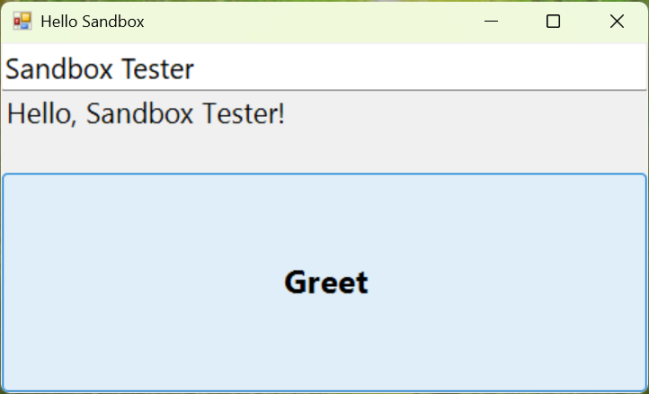

# sandbox-mcp

**Fresh, throwaway Windows machines for testing your apps.** One command (or one MCP tool call) boots a clean
Windows 11 in [Windows Sandbox](https://learn.microsoft.com/windows/security/application-security/application-isolation/windows-sandbox/),
copies your build in, runs it, drives its UI, screenshots it, checks for crashes, copies the results out and
deletes the machine. About 35 seconds, start to finish.

```text
> sbx run .\samples\HelloSandbox\bin --test .\samples\HelloSandbox\test.ps1

[sbx] booting a fresh Windows Sandbox (network on)
[sbx] started 4ebd5e89-0df5-457e-b15e-70f48dce0591
[sbx] ip 172.25.229.32
[sbx] folders shared
[sbx] user session ready
[sbx] agent up as 6CB5E6E5-FD41-4\WDAGUtilityAccount
[sbx] copying D:\github\sandbox-mcp\samples\HelloSandbox\bin to C:\apps\HelloSandbox
[sbx] running HelloSandbox.exe
[sbx] running test test.ps1
[sbx] destroying the sandbox
PASS  HelloSandbox.exe on a fresh Windows Sandbox (37.4s)
  sandbox  network on, booted in 14.9s
  process  still running, window "Hello Sandbox"
  crashes  none
  test     test.ps1 passed
  shots    3 screenshot(s)
  report   C:\Users\you\AppData\Local\sandbox-mcp\runs\20261106-190012\out\report.md
```

The test script typed a name into the app with UI Automation, clicked **Greet** and waited for the answer. This is the
screenshot it brought back from inside the sandbox:



It's both:

- an **MCP server** so AI agents (GitHub Copilot, Claude, Cursor, VS Code, ...) can test the apps they just built
  on a machine that isn't yours, and
- a **CLI (`sbx`)** for you, your scripts and your CI.

They share state, so you can `sbx start`, let an agent poke at the app, then `sbx stop`.

## Why

"It works on my machine" is usually true: your machine has every runtime, SDK, redistributable, font, registry key
and PATH entry you ever installed. Your users' machines don't. Windows Sandbox is a pristine Windows that boots in
seconds and is **deleted** when it closes, which makes it the perfect "brand-new customer PC". But it has no API:
it was built for a person clicking around. sandbox-mcp makes it scriptable.

|                              | sandbox-mcp (Windows Sandbox)       | Hyper-V / VMware VM        | Windows containers           | Cloud dev VMs (devvm, Codespaces, Dev Box) |
|------------------------------|-------------------------------------|----------------------------|------------------------------|--------------------------------------------|
| Real Windows desktop + GUI   | ✅                                  | ✅                         | ❌ no desktop                 | Linux mostly / ✅ (Dev Box)                 |
| Clean state every run        | ✅ always, by design                | snapshots to manage        | ✅                            | ❌ persistent                               |
| Startup                      | ~15 s                               | minutes                    | seconds                      | minutes                                    |
| Images to build or download  | none (uses your installed Windows)  | a 20+ GB VHD               | multi-GB base images         | none, but it's someone else's computer     |
| Cost                         | free with Windows Pro/Enterprise    | free-ish + disk            | free                         | 💸                                          |
| Runs offline / local         | ✅                                  | ✅                         | ✅                            | ❌                                          |
| Parallel instances           | ❌ one at a time                    | ✅                         | ✅                            | ✅                                          |
| Persistent environment       | ❌                                  | ✅                         | via volumes                  | ✅                                          |

If you need many machines, persistence, or Linux, use a VM or a cloud box. If you want to know *"does my Windows app
install, launch and work on a clean PC, and what does it look like?"* as quickly and cheaply as possible, this is it.

## What you can do

- **Clean-machine smoke tests:** does the exe even start without the VC++ runtime / .NET runtime / WebView2 you
  forgot to bundle? `sbx run` tells you, with a screenshot and the crash events.
- **Test installers and uninstallers:** `sbx install-test setup.msi` installs on a clean machine, uninstalls, and
  reports every file, registry key, service, scheduled task and autorun the installer added and the uninstaller
  forgot. Hung installers waiting on a hidden dialog get screenshotted instead of hanging your CI.
- **Drive the UI with UI Automation, not pixels:** read the control tree (`Button "Save" #SaveButton {invoke}`),
  set text, click, toggle, select, wait for results. Works for WinForms, WPF, Win32 and WinUI apps, and things like
  File Explorer. Screenshots, mouse and keyboard are there for everything else.
- **Let an agent close the loop:** "build it, test it on a clean machine, look at the screenshot, fix it, repeat",
  without the agent touching your real desktop.
- **Run things with no network at all:** `--network off` boots the sandbox with no network adapter. Control still
  works (through a shared folder), so you can watch an app's offline behavior or open something you don't trust.
- **See what a file you don't trust actually does:** `sbx detonate invoice.js` runs it in a sandbox with no network
  and reports every process it started (with command lines), the names it looked up, the addresses it tried, and the
  autoruns, scheduled tasks, services and files it planted. Then the whole machine is deleted.
- **Collect evidence:** every run keeps screenshots, copied-out files, a markdown report and an audit log on the
  host after the sandbox is gone.

## Download and try it (no Node.js install)

Download the **Windows x64 portable ZIP** from the [latest GitHub release](https://github.com/shanselman/sandbox-mcp/releases/latest)
and extract it. The ZIP includes `sbx`, the MCP server, their dependencies, the guest agent and skill, and a private
Node.js runtime. You do not need to clone the repo, install Node/npm, or add anything to PATH.
The package is built and tested on native Windows x64; ARM64 is not currently packaged.

Newly published releases include this ZIP; older releases without a Windows download contain only source archives.

Open PowerShell in the extracted folder and start with the read-only readiness check:

```powershell
.\sbx.cmd doctor
```

`doctor` explains what is missing and how to fix it. It never enables Windows features, elevates, changes PATH, or
restarts the PC for you. Windows Sandbox is only available on Windows Pro, Enterprise or Education; Windows Home
and Windows Server cannot run it.

If the Sandbox feature is off, open **an administrator PowerShell**, run the command below, then restart Windows:

```powershell
Enable-WindowsOptionalFeature -Online -FeatureName Containers-DisposableClientVM -All
```

After restarting, open **Windows Sandbox from the Start menu once**, then close it. This updates Sandbox and installs
the `wsb` command-line tool that `sbx` uses. Run the check again and try a built-in Windows app:

```powershell
.\sbx.cmd doctor
.\sbx.cmd run C:\Windows\System32\charmap.exe --open
```

For an MCP client, configure its stdio server with the full paths to the bundled runtime and server. Replace the
example folder with the location where you extracted the ZIP:

```json
{
  "servers": {
    "windows-sandbox": {
      "type": "stdio",
      "command": "C:\\Users\\you\\Downloads\\sandbox-mcp\\node.exe",
      "args": ["C:\\Users\\you\\Downloads\\sandbox-mcp\\src\\server.js"]
    }
  }
}
```

Claude Desktop and some other clients use `"mcpServers"` instead of `"servers"`. The server writes startup logs to
stderr; its stdout is reserved for MCP messages.

## Turn on Windows Sandbox

If you have Windows Pro, Enterprise or Education, you already own one of the best tools in Windows and it's probably
switched off. [Windows Sandbox](https://learn.microsoft.com/windows/security/application-security/application-isolation/windows-sandbox/windows-sandbox-overview)
is a whole, real Windows desktop that:

- **comes with Windows:** nothing to download, no VHD, no license key. It's built from the Windows you're running.
- **is brand new every time:** it boots as clean as the day Windows was installed, in about 15 seconds.
- **is thrown away when you close it:** every file, registry key and installed app is deleted. Nothing leaks back.
- **is properly isolated:** it runs on its own kernel behind the Microsoft hypervisor (the same hardware
  virtualization as Hyper-V), not just a separate user account.
- **is light:** it shares memory and files with your PC where it safely can, and uses your GPU.

Turn it on with one line in an **admin** PowerShell, then restart:

```powershell
Enable-WindowsOptionalFeature -Online -FeatureName Containers-DisposableClientVM -All
```

(Or *Turn Windows features on or off* > tick *Windows Sandbox*.) After the restart, **open Windows Sandbox from the
Start menu once**. That updates it to the Store version, which includes the `wsb` command-line tool this project
drives. Then check everything with:

```powershell
sbx doctor
```

```text
✅ Windows 11 Pro, build 26100
✅ Windows Sandbox feature is on
✅ Virtualization is on
✅ wsb command-line tool: C:\Users\you\AppData\Local\Microsoft\WindowsApps\wsb.exe (Windows Sandbox 0.8.107.0)
✅ Node.js 22.11.0

Ready. Try: sbx run C:\Windows\System32\charmap.exe --open
```

If something's missing, `sbx doctor` says what and how to fix it, and every other command tells you the same thing
if it can't reach Windows Sandbox. The full list of what you need:

- Windows 11 24H2 (build 26100) or later, Pro / Enterprise / Education. Windows Sandbox isn't available on Home or Windows Server.
- Virtualization turned on in your PC's UEFI/BIOS (Intel VT-x or AMD-V). Most PCs ship with it on.
- At least 4 GB of RAM (8 GB recommended), 2 CPU cores and 1 GB of free disk.
- Running inside a VM? Turn on nested virtualization on the host first:
  `Set-VMProcessor -VMName <name> -ExposeVirtualizationExtensions $true`.
- The portable ZIP bundles Node.js for Windows x64. If installing from source, use Node.js 20+ (`winget install OpenJS.NodeJS.LTS`).

## Install from source

```powershell
git clone https://github.com/shanselman/sandbox-mcp
cd sandbox-mcp
npm install
npm link            # puts `sbx` and `sandbox-mcp` on your PATH (or use `node src/cli.js`)

sbx doctor                                         # is Windows Sandbox ready? (see above)
sbx run C:\Windows\System32\charmap.exe --open     # try it on something that exists everywhere
```

Try the included sample (needs nothing but Windows; it compiles with the .NET Framework's `csc.exe`):

```powershell
.\samples\HelloSandbox\build.ps1
sbx run .\samples\HelloSandbox\bin --test .\samples\HelloSandbox\test.ps1   # passes
sbx run .\samples\HelloSandbox\bin --args --crash                            # fails, and shows the crash
sbx install-test .\samples\LeakyApp\install.ps1                              # an installer whose uninstaller forgets things
sbx detonate .\samples\Suspicious\suspicious.ps1                             # a harmless script that acts like malware
```

### Use it from an agent (MCP)

Add the server to your MCP client. For example VS Code (`.vscode/mcp.json`) or GitHub Copilot CLI
(`~/.copilot/mcp-config.json`):

```json
{
  "servers": {
    "windows-sandbox": {
      "type": "stdio",
      "command": "node",
      "args": ["C:\\path\\to\\sandbox-mcp\\src\\server.js"]
    }
  }
}
```

(Claude Desktop and others use `"mcpServers"` instead of `"servers"`. After `npm link` you can use
`"command": "sandbox-mcp"` with no args.)

Then ask: *"Build the app, run it in a fresh Windows Sandbox, type my name in the box, click Greet and show me a
screenshot."*

There's also an agent skill in [`skills/windows-sandbox-app-test`](skills/windows-sandbox-app-test/SKILL.md) that
teaches agents the workflow; copy it into your agent's skills folder (for example `~/.copilot/skills/`).

## MCP tools

| Tool | What it does |
|---|---|
| `sandbox_run` | The whole loop in one call: boot, copy in, launch or run, observe, test script, collect, destroy, report. |
| `sandbox_start` | Boot a fresh sandbox (`network`: on / firewall / off, `memoryMB`, `vGpu`). Waits until the guest agent answers. |
| `sandbox_status` | Is one running, its id/IP/network mode, is the agent healthy. |
| `sandbox_stop` | Destroy it. Lists the artifacts left on the host. |
| `sandbox_copy_in` | Copy a host file or folder in (default `C:\apps\<name>`). |
| `sandbox_copy_out` | Copy a sandbox file or folder out to the run's `out\files`. |
| `sandbox_exec` | Run a PowerShell (or `cmd`) command; returns stdout, stderr, exit code. |
| `sandbox_launch` | Start a GUI app without waiting; returns pid and main window. |
| `sandbox_process` | Running? Exit code? Window title? |
| `sandbox_windows` | Visible top-level windows with titles, pids and bounds. |
| `sandbox_screenshot` | PNG of the desktop or one window, returned inline (and saved on the host). |
| `sandbox_click` / `sandbox_type` | Mouse and keyboard, in screenshot coordinates / SendKeys syntax. |
| `sandbox_ui_tree` | The UI Automation tree of a window: type, name, automation id, value, state, supported actions. |
| `sandbox_ui_action` | Find a control by name / automation id / type and click, set a value, toggle, select, expand, read... |
| `sandbox_ui_wait` | Wait for a control (a result, a dialog) to appear. |
| `sandbox_app_errors` | Application event log errors: crashes, hangs, .NET unhandled exceptions. |
| `sandbox_install_test` | The installer loop in one call: snapshot, install, snapshot, optional test, uninstall, snapshot, report what was added and left behind. |
| `sandbox_detonate` | Run an untrusted file (no network by default) and report its processes, lookups, connections, persistence and changes. |
| `sandbox_snapshot` | Record files, registry, services, autoruns and installed programs under a name. |
| `sandbox_diff` | Compare two snapshots: what changed in between. |

## CLI

```text
sbx run <app.exe|folder> [--exe <name>] [--args "<args>"] [--console] [--wait <sec>]
                         [--test <script.ps1>] [--collect <sandbox path>]... [--keep] [--open]
sbx install-test <setup.msi|.exe|.ps1|.cmd> [--args "/S"] [--uninstall auto|none|"<cmd>"]
                         [--uninstall-args "/S"] [--test <script.ps1>] [--fail-on-leftovers] [--exclude <path>]...
sbx detonate <file> [--args "<args>"] [--network off|firewall|on] [--duration <sec>] [--full] [--every <sec>]

sbx start [--network on|firewall|off] [--memory <MB>] [--no-gpu] [--minimized]
sbx push <host path> [sandbox path]          sbx pull <sandbox path> [name]
sbx exec [--cmd] [--cwd <dir>] <command...>  sbx launch <exe> [--args "..."]
sbx shot [--window <title>|--pid <pid>]      sbx windows   sbx proc <pid>
sbx ui [tree] [--pid <pid>]                  sbx ui click --name Save
sbx ui set --id NameBox --value Scott        sbx ui wait --name "Saved" --timeout 10
sbx snapshot <name> [--exclude <path>]...    sbx diff <from> <to>
sbx click <x> <y>   sbx type "text" [--keys] sbx errors   sbx status   sbx stop
sbx doctor                                   # can this PC run Windows Sandbox? how to fix it if not
sbx mcp                                      # run the MCP server
```

Add `--json` to any command for machine-readable output. `sbx exec` and `sbx run` exit with meaningful codes, so they
drop straight into scripts. `sbx help` has the details.

## Test scripts

`sbx run --test smoke.ps1` (or `sandbox_run` with `testScript`) runs your script **inside** the sandbox after the app
starts, with:

- `$env:SBX_APP_PID`, `$env:SBX_APP_DIR`, `$env:SBX_OUT` (anything you write to `SBX_OUT` comes back to the host),
- these commands already imported:

```powershell
Get-SbxUiTree [-ProcessId <pid>] [-WindowTitle <title>] [-Depth <n>]     # objects: type, name, automationId, value, actions...
Invoke-SbxUi  -Action <click|setvalue|toggle|select|expand|read|...> [-Name <text>] [-AutomationId <id>]
              [-ControlType <Button|Edit|...>] [-Index <n>] [-Value <text>] [-ProcessId <pid>]
Wait-SbxUi    [-Name <text>] [-AutomationId <id>] [-ControlType <type>] [-TimeoutSec <n>] [-ProcessId <pid>]
```

Throw, or exit non-zero, to fail the run. Example ([samples/HelloSandbox/test.ps1](samples/HelloSandbox/test.ps1)):

```powershell
$app = [int]$env:SBX_APP_PID
Invoke-SbxUi -ProcessId $app -AutomationId NameBox -Action setvalue -Value 'Sandbox'
Invoke-SbxUi -ProcessId $app -Name Greet -Action click
Wait-SbxUi   -ProcessId $app -Name 'Hello, Sandbox!' -TimeoutSec 5 | Out-Null
```

## Installer testing

Installers are the part of an app that only ever runs on clean machines, so they're the part you test least.
`sbx install-test` takes a system snapshot of a fresh sandbox, runs your installer silently, snapshots again,
uninstalls it the way Add/Remove Programs would, snapshots a third time and diffs them:

```text
> sbx install-test .\7z2501-x64.msi --offline

PASS  7z2501-x64.msi on a fresh Windows Sandbox (117.5s)
  install    exit 0 in 2.5s
  added      7-Zip 25.01 (x64 edition); 111 files, 18 registry keys, 0 services, 0 autorun/env values
  uninstall  7-Zip 25.01 (x64 edition): exit 0 in 2.3s
  leftovers  none, clean uninstall
```

The report lists what was added (here: `C:\Program Files\7-Zip`, the Start menu folder, the shell extension
CLSIDs and context-menu handlers, App Paths and the uninstall entry) and what's **left behind**. Try the included
deliberately sloppy installer, whose uninstaller only deletes its program folder:

```text
> sbx install-test .\samples\LeakyApp\install.ps1

## Left behind after uninstall
Services:  added service LeakyUpdater "Leaky App Updater", automatic: "C:\Program Files\LeakyApp\updater.exe"
Autoruns:  added HKCU\Software\Microsoft\Windows\CurrentVersion\Run\LeakyUpdater
Files:     C:\ProgramData\LeakyApp\   C:\Users\WDAGUtilityAccount\AppData\Roaming\LeakyApp\
           C:\Windows\System32\Tasks\LeakyApp Daily Check
Registry:  HKLM\SOFTWARE\LeakyApp
```

- `.msi` files get `msiexec /i /qn /norestart` with a verbose log (brought back, with its errors in the report).
  For `.exe` installers pass the silent switch: `--args /S` (NSIS), `/VERYSILENT` (Inno), `--silent` (Squirrel).
- The uninstall uses what the installer registered: `msiexec /x {ProductCode}`, else `QuietUninstallString`, else
  `UninstallString` plus `--uninstall-args`. The run fails if the program is still in Add/Remove Programs afterwards.
- An installer that doesn't exit within `--timeout` is screenshotted (and its new windows' UI Automation tree
  recorded) before it's killed. That's usually a "silent" install that's waiting for someone to click a dialog.
- Processes the installer leaves running (tray apps, updaters) are listed and stopped before uninstalling.
- `--test smoke.ps1` runs between install and uninstall with `$env:SBX_INSTALL_DIR` and `$env:SBX_PROGRAM`.
- `--fail-on-leftovers` turns leftovers into a failure, for CI.
- The snapshots skip the things Windows changes on its own (caches, telemetry, Defender, Windows Update, Start menu
  and Explorer bookkeeping, Windows Installer's internal database), so a 30-second idle sandbox diffs to "No changes".
  `--exclude` adds more.

The same snapshots are available step by step: `sbx snapshot before`, do anything, `sbx snapshot after`,
`sbx diff before after` (or the `sandbox_snapshot` / `sandbox_diff` tools).

## Detonate: what does this file actually do?

Someone sent you `invoice.js`, a "driver update", a script from a forum. `sbx detonate` runs it the way a
double-click would, in a fresh sandbox with **no network adapter**, with Windows' own auditing switched on, and
tells you what it did:

```text
> sbx detonate .\samples\Suspicious\suspicious.ps1 --network firewall

suspicious.ps1: 3 red flag(s) (watched 40s, network firewall)
  findings   🔴 starts itself with Windows: added HKCU\Software\Microsoft\Windows\CurrentVersion\Run\ContosoUpdater =
                powershell.exe -WindowStyle Hidden -ExecutionPolicy Bypass -File "C:\Users\...\ContosoUpdater\updater.ps1"
             🔴 created a scheduled task: ContosoUpdate
             🔴 put something in a Startup folder: C:\Users\...\Start Menu\Programs\Startup\contoso.cmd
             🟠 wrote 2 runnable file(s): C:\Users\...\ContosoUpdater\updater.ps1, ...\Startup\contoso.cmd
             🟠 ran built-in Windows tools that malware often uses: schtasks.exe, whoami.exe, ipconfig.exe, net.exe, net1.exe
             🟠 looked up 1 internet name(s): c2.contoso-updates.example
             🟠 tried to connect to 2 address(es): 198.51.100.7:4444, 203.0.113.10:80
  processes  7 (powershell.exe → conhost.exe → schtasks.exe → whoami.exe → ipconfig.exe …)
  network    1 name lookup(s), 2 connection attempt(s)
  changed    4 files added, 0 changed, 2 registry keys, 1 autorun/env values, 0 services
```

([samples/Suspicious/suspicious.ps1](samples/Suspicious/suspicious.ps1) is harmless; it just behaves like
something that isn't.) The report also has a timeline:

```text
  +0.0s  start    powershell.exe (pid 8180)  ... -File "C:\Users\WDAGUtilityAccount\Downloads\suspicious.ps1"
  +1.5s  start    schtasks.exe (pid 7848)  /Create /F /TN ContosoUpdate /SC ONLOGON /TR "powershell.exe -WindowStyle Hidden ..."
  +1.6s  start    whoami.exe (pid 7616)  /all
  +1.7s  start    net.exe (pid 9064)  user
  +1.7s  start    net1.exe (pid 8096)  C:\Windows\system32\net1 user
 +15.0s  lookup   c2.contoso-updates.example (failed)
 +15.1s  connect  203.0.113.10:80/TCP blocked (powershell.exe)
 +15.2s  connect  198.51.100.7:4444/TCP blocked (powershell.exe)
```

plus the process tree, a before/after diff of files, registry, services and autoruns, the windows it opened,
screenshots, and "everything else that happened" (usually Windows itself, kept separate rather than hidden).

- **How:** process creation auditing with command lines (Security 4688), Windows Filtering Platform connection
  auditing (5156/5157) and the DNS client log, collected from inside the guest, plus the same snapshots as
  `install-test`. Activity is attributed to the file's own process tree, so the agent's own work isn't mixed in.
- **Network:** `off` (default) has no adapter at all. Name lookups are still recorded, but nothing leaves the
  machine. `--network firewall` also shows the IP addresses and ports it tries, blocked by the guest firewall.
  `on` gives it the internet; only use that for things you're prepared to let talk to the world.
- **Runs:** `.exe`, `.msi` (silently), `.ps1`, `.cmd`, `.bat`, `.js`/`.jse`/`.vbs`/`.vbe`/`.wsf` (with `wscript`) and
  `.hta` (with `mshta`), from the user's Downloads folder.
- **Watching:** up to `--duration` seconds (60), stopping early once everything it started has exited, unless
  `--full`. A screenshot every `--every` seconds (15).
- **Findings are heuristics, not a verdict.** Installers add autoruns and services too. Exit code 0 means "it was
  observed", not "it's safe". This is a quick first look on your own PC, not a malware lab: something that checks
  whether it's in a sandbox can just behave nicely.

## Network modes

| Mode | How | Use it for |
|---|---|---|
| `on` (default) | Normal NAT networking. | Apps that need the internet, downloading prerequisites. |
| `firewall` | Guest firewall blocks all outbound traffic (DNS included); only the control channel from the host is allowed. | Testing offline behavior quickly. Admin code in the guest *could* undo it. |
| `off` | The sandbox has **no network adapter**. sandbox-mcp talks to it through a shared-folder mailbox (~100 ms per call). | Untrusted files (the default for `detonate`), and proving an app works with no network at all. |

In `firewall` and `off` mode, sandbox-mcp also switches off Smart App Control in the guest. It ships in evaluation
mode and asks the cloud about every new exe and msi; with no internet each of those lookups hangs for about two
minutes (a 2 MB MSI took 125 s to install instead of 1 s).

## Security notes

- Each sandbox is a separate Hyper-V-isolated kernel. It's thrown away on stop, together with everything that ran in it.
- Hardened defaults: clipboard, printer, microphone and camera redirection are off, and *Protected Client* mode is on.
- The host shares exactly three folders: the guest agent (read-only), a staging folder for files you copy in
  (read-only) and an output folder (read-write). Nothing else from your disk is visible.
- The control channel needs a random per-sandbox token. In `on`/`firewall` mode it's TCP to the sandbox's private
  NAT address; in `off` mode it's the shared folder.
- `SANDBOX_MCP_ALLOWED_ROOTS` limits which host folders can be copied in (handy when an agent is driving).
- Every operation is appended to `audit.jsonl` in the run folder.
- When the MCP client disconnects, the sandbox is destroyed. An idle watchdog inside the guest shuts it down after
  30 minutes with no calls.
- With `network: on` the guest has internet access like any other machine on your network's NAT. Use `off` for
  anything you don't trust.
- The `out` folder is writable from inside the sandbox, so treat what comes back (screenshots, pulled files, logs)
  as untrusted, especially after `detonate`. sandbox-mcp reads data from it but never runs anything from it.
- Windows Sandbox is strong isolation, but not a guarantee: a hypervisor or Windows Sandbox escape would be a
  zero-day. For real malware analysis use a dedicated, disposable analysis machine.

## Configuration

| Environment variable | Default | |
|---|---|---|
| `SANDBOX_MCP_HOME` | `%LOCALAPPDATA%\sandbox-mcp` | Where runs, screenshots and reports are kept. |
| `SANDBOX_MCP_ALLOWED_ROOTS` | (any) | `;`-separated host folders that may be copied into the sandbox. |
| `SANDBOX_MCP_IDLE_MINUTES` | `30` | Guest shuts itself down after this long with no calls. `0` disables. |
| `SANDBOX_MCP_KEEP_ON_EXIT` | (unset) | Set to `1` to leave the sandbox running when the MCP client disconnects. |

## How it works

Windows Sandbox has no COM or WMI API. Since Windows 11 24H2 its Store version ships `wsb.exe`
(`start / stop / list / ip / exec / share / connect`), but `wsb exec` returns only an exit code: no output, no
screenshots, no UI. So:

1. The host creates a run folder and calls `wsb start` with a hardened config (and `<Networking>Disable` in `off` mode).
2. It shares the guest agent folder and starts [`agent/agent.ps1`](agent/agent.ps1) inside with `wsb exec`, in the
   interactive user session (it needs a desktop for windows and screenshots).
3. The agent is a small PowerShell server: exec with real output, file copy, process launch, screenshots, mouse and
   keyboard, window list, event log, and UI Automation through [`agent/uia.cs`](agent/uia.cs). That uses *native* UI
   Automation (the managed `System.Windows.Automation` can't see inside WinForms apps), with an interop assembly
   generated on the fly from the OS type library, so nothing needs installing.
4. With the network on, the host talks to it over TCP. In `off` mode it uses a mailbox in the shared folders.
   (The guest caches "file not found" for ~5 s, so the host bumps a sequence file the guest polls, bringing a round
   trip from 5 s down to ~100 ms.)
5. `wsb stop` destroys the VM. The run folder stays on the host.

## Limits

- **One sandbox at a time.** That's a Windows Sandbox rule. `sbx run` calls queue nothing; they fail fast if one is running.
- Every boot is pristine, so prerequisites get installed every time (that's the point, but it costs time).
- No Microsoft Store apps, winget, Notepad, Calculator or Windows Terminal inside. Windows PowerShell 5.1 and
  .NET Framework 4.8 are there.
- The first UI Automation call in a sandbox takes ~4 s (it generates the interop); later calls are fast.
- A system snapshot takes 10-20 s (about 11k files, 340k registry keys, 700 services), so `install-test` takes
  roughly two minutes plus your installer's own time.
- The guest desktop gets a plain background so screenshots stay around 100 KB instead of 16 MB.
- Needs a logged-in Windows session on the host (Windows Sandbox is a desktop feature).

## Related projects

- [fmuecke/windows-sandbox-mcp](https://github.com/fmuecke/windows-sandbox-mcp) is another MCP server for Windows
  Sandbox, focused on running agent-generated code safely and with `Networking Disable` by default. Its ideas
  (true offline by default, stop on disconnect, an idle watchdog, an audit log, allowed folders) shaped this
  project. sandbox-mcp leans the other way: testing *your* app on a clean machine, with UI Automation, screenshots
  and one-shot reports.
- [devvm.dev](https://devvm.dev/): disposable cloud dev machines for agents. The inspiration for "just give the agent a fresh box".

## License

[MIT](LICENSE)
